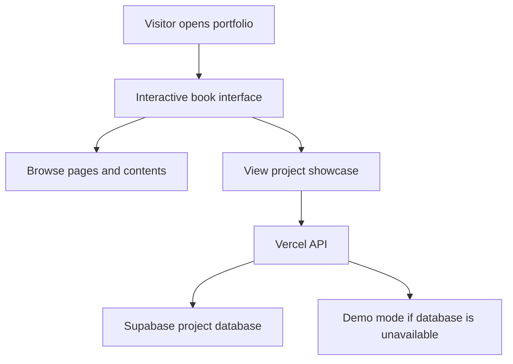
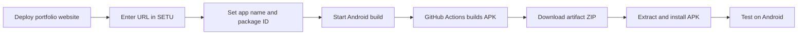

# 📖 Ansh Gajjar — Book Portfolio

> **A developer portfolio designed like an interactive book.**  
> Turn the pages to explore projects, skills, and the developer journey.

  <a href="https://book-portfolio-green.vercel.app/"><strong>🌐 Live Portfolio</strong></a>
  ·
  <a href="https://github.com/ansh385/book-portfolio"><strong>💻 Source Code</strong></a>
  ·
  <a href="https://setu-native-builder.vercel.app/"><strong>📱 Convert to Android with SETU</strong></a>

---

## ✨ About the project

This portfolio presents a developer's work as a digital book instead of a conventional scrolling page. Visitors can flip through sections and discover projects in an immersive, book-inspired layout.

### Highlights

- 📚 **Book-style navigation** — browse portfolio sections as pages.
- ↔️ **Multiple navigation methods** — page arrows, keyboard arrow keys, touch swipes, and the Contents page.
- 📱 **Responsive experience** — two-page spreads on wider screens and a single page on narrow screens.
- 🧩 **Project showcase** — display projects and their links.
- 🔐 **Admin project management** — use the `#admin` view to add or remove projects.
- ☁️ **Vercel deployment** — serverless API for project data.
- 🧪 **Demo mode** — if the database is unavailable, the portfolio can show demo content and store changes locally in that browser.

## 🛠️ Built with

- HTML5
- CSS3
- JavaScript
- Bootstrap 5
- Supabase for project data
- Vercel Serverless Functions

## 🗂️ Project structure

| File | Purpose |
| --- | --- |
| `index.html` | Portfolio book structure and page content |
| `style.css` | Layout, styling, and responsive behavior |
| `book.js` | Book/page-turning interactions |
| `script.js` | Project loading and project-related behavior |
| `api/projects.js` | Serverless endpoint for project data |
| `supabase.sql` | Database setup script |

## 🧭 How it works

## 🚀 Run or deploy the website

### Deploy with GitHub and Vercel

1. Push this repository to GitHub.
2. Open [Vercel](https://vercel.com/new) and import this repository.
3. Choose **Other** as the framework preset and leave the build command empty for this plain HTML/CSS/JS project.
4. Create a Supabase project and run the SQL in `supabase.sql` in its SQL Editor.
5. In Supabase **Project Settings → API**, copy the project URL and service-role key.
6. In Vercel **Project → Settings → Environment Variables**, add:

   | Variable | Value |
   | --- | --- |
   | `SUPABASE_URL` | Your Supabase project URL |
   | `SUPABASE_SERVICE_KEY` | Your Supabase service-role key |
   | `ADMIN_PASSWORD` | A strong, unique admin password |

7. Redeploy the Vercel project.
8. Open your deployed site and verify the portfolio and project list.

> 🔒 **Security:** Never put `SUPABASE_SERVICE_KEY` or `ADMIN_PASSWORD` in client-side HTML or JavaScript, and never commit them to GitHub.

### Manage portfolio projects

1. Open your deployed portfolio with `#admin` at the end of the URL, for example `https://your-site.vercel.app/#admin`.
2. Enter the configured admin password.
3. Use the project controls to add or remove projects.

Visitors who open the normal URL see the public portfolio. You can also edit project records directly in the Supabase Table Editor.

## 📱 Turn this website into an Android app with SETU

[SETU Native Builder](https://setu-native-builder.vercel.app/) packages a website into an installable Android app. The app opens your website in a standalone app window; it does **not** automatically rewrite the website into native Android screens.

### Build an APK

1. **Deploy your portfolio first.** Confirm the live website works in a mobile browser. Example portfolio URL: `https://book-portfolio-green.vercel.app/`. If your deployment URL is different, use your actual live URL.
2. Open [SETU Native Builder](https://setu-native-builder.vercel.app/).
3. Enter your deployed portfolio URL, including `https://`.
4. Set the app name to **Book Portfolio**.
5. Use a unique Android package ID, for example `com.ansh385.bookportfolio`.
6. Review the preview and start the Android build.
7. Wait for the build status to report success.
8. Open the build's GitHub Actions run and find **Artifacts**.
9. Download the Android APK artifact ZIP to your device.
10. Extract the ZIP and locate the `.apk` file.
11. Open the APK on your Android device and follow the installation prompts. Only install APKs you trust.
12. Launch **Book Portfolio** and test page turning, touch gestures, links, project loading, and the admin flow if you need it.

### SETU build flow

### Important notes

- **Website updates:** If you update the hosted portfolio, the installed wrapper usually loads the updated site when it connects to the internet. Some assets may be cached.
- **Internet connection:** This is a website wrapper, so the portfolio and server-backed project data generally require internet access. It is not automatically an offline app.
- **App identity:** Choose the final app name and package ID before distributing the app; changing the package ID later creates a different Android app identity.
- **Google Play:** The debug APK is suitable for testing. Publishing to Google Play requires the appropriate release-signing setup and Play Console configuration.
- **Build service setup:** SETU's owner must configure its GitHub Actions integration in Vercel. Never place a GitHub token in this portfolio repository, the browser, or a public README.

## 🧰 Local development

Because this is a plain HTML/CSS/JavaScript project, you can open `index.html` for a basic preview. For API-backed project data, run it through the configured Vercel deployment or a local setup that supports the serverless API and environment variables. Opening the HTML file directly may use demo mode.

## 🗺️ Roadmap ideas

- [ ] Add a custom favicon and app icon.
- [ ] Add a dedicated mobile testing checklist.
- [ ] Review accessibility for keyboard and screen-reader users.
- [ ] Add screenshots or a short demo GIF of the page-turning interaction.

## 👤 Author

**Ansh Gajjar**

- Portfolio: [book-portfolio-green.vercel.app](https://book-portfolio-green.vercel.app/)
- GitHub: [@ansh385](https://github.com/ansh385)

---

  <em>Every project is a page. Every page tells a story.</em>

